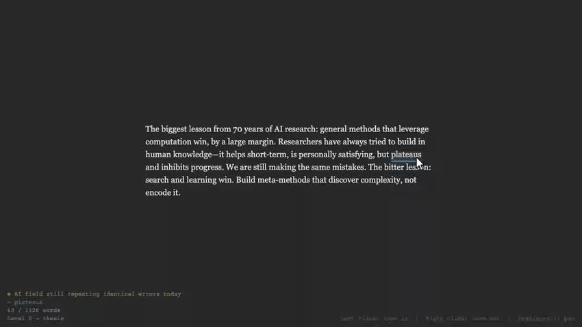

# Semantic Zoom

[](media/bitter-lesson-zoom.mp4)

Canvas-based reader for zooming through prose without losing your place.
Right-click a word to zoom into more detail, left-click to zoom out, and the
text under the cursor stays anchored to the same idea. Drag, scroll, or use
the right scrollbar to pan long levels.

The checked-in corpora run entirely from static JSON:

- `the-bitter-lesson-auto.json` - public-domain essay
- `ada-lovelace-wikipedia-auto.json` - reference biography excerpt
- `fair-guiding-principles-excerpt-auto.json` - research-paper excerpt

## Quickstart

```bash
npm install
npm run dev
```

Open `http://localhost:5181/?file=the-bitter-lesson-auto.json`.

Use the picker in the upper-right corner to switch corpora.

## Controls

- Right click over text: zoom in.
- Left click over text: zoom out.
- Plus and minus keys: zoom in and out.
- Mouse wheel or trackpad scroll: pan normally.
- Drag on the text area: pan the current level.
- Right scrollbar: drag or page through long levels.

## Add Your Own Text

Press **+ Add a text** under the picker in the upper-right corner. Give it a
title and fill the text box one of three ways: paste the text, paste a link
and press Fetch, or choose a PDF, Word (.docx) or plain-text file. Check the
text, then press **Build zoom levels**. A text needs at least 300 words. When the build finishes, the text
opens and joins the picker under "Your texts".

The zoom levels are written by [Claude Code](https://claude.com/claude-code)
on your own computer, on your own Claude subscription. Install it and sign in
once; there is no API key and nothing is sent to a server of ours. If Claude
Code is missing, the panel says so and offers a prompt you can hand to your
own Claude to set everything up.

Added texts are saved in `data/library/`, which git ignores. The button needs
the local dev server (`npm run dev`); a static build has no helper behind it.

## Validate

```bash
npm test
```

This runs the corpus validator and a production build. The validator checks
tree shape, phrase links, concept-anchor bounds, and missing visible anchors.
Warnings identify data quality issues worth inspecting, but only validation
errors fail the command.

## Generate A Corpus

The demo data is prebuilt. Generating new corpora is optional and requires a
local `claude` CLI in `PATH`.

```bash
npm run ingest:fast -- data/my-document.txt
```

Then add the generated `my-document-auto.json` file to the picker in
`index.html`. The **+ Add a text** button runs this same tool and lists the
result for you.

Useful options:

```bash
npm run ingest:fast -- data/my-document.txt --levels 6 --concept-count 16
npm run ingest:fast -- data/my-document.txt --effort medium --no-batch
npm run repair:links -- data/my-document-auto.json --phrase-maps
```

The pipeline is intended to be automatic. Do not hand-author per-document
concept files; stale or invalid anchors should be regenerated or repaired by
generic tooling.

## Architecture

- `src/main.js` - app boot, input handling, zoom anchoring, hit testing,
  debug API.
- `src/renderer.js` - canvas drawing.
- `src/text-layout.js` - line wrapping and measurement.
- `src/add-text.js` - the Add a text panel.
- `server/library-api.js` - local helper for the panel: link fetching, the
  build job, the list of added texts.
- `tools/ingest-fast.js` - one-command corpus ingest path.
- `tools/extract-concepts.js` - concept extraction and anchor placement.
- `tools/rebuild-levels.js` - source-to-level rebuild for polished corpora.
- `tools/rebuild-child-links.js` - model-free parent/child link repair.
- `tools/validate-data.js` - static corpus validation.

The runtime uses two anchor layers:

- `concepts[].anchors[level]` preserves semantic identity across zooms.
- `nodes[].phrases[].matchIn/matchOut` provides a phrase-chain fallback and
  helps choose the best surviving word when text changes between levels.

The debug surface is available as `window._sz` while the app is running. See
`VERIFY.md` for the invariants and browser-check procedure.

## Data And Licensing

Source attribution for checked-in corpora is in `data/SOURCES.md`. Third-party
package and model notices are in `THIRD_PARTY_NOTICES.md`. Generated JSON
corpora are derived from the adjacent `.txt` files and inherit their source
text licenses. The application code is MIT licensed.
